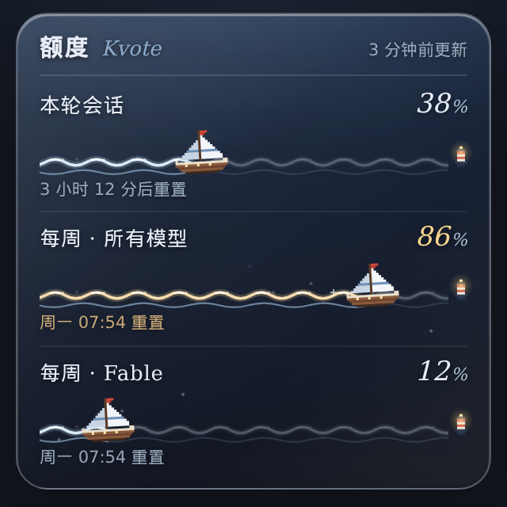

# kvote：Claude 订阅额度卡，不碰 token

把 Claude 订阅的额度做成一张深海玻璃小卡片。每个额度窗口画成一行海，像素小帆船开到哪里，就是用了多少。尽头有一只红白浮标，船开到浮标就是用满了。



（截图里是示例数据）

- **不碰登录凭证，也不调任何接口。** 用量直接取自 Claude Code 自己给出的数据，具体是下面「数据从哪来」里的三种办法之一。
- 服务端只有一个 Python 文件，只用标准库，不用装任何依赖。
- 网页卡片由一个 JS 和一个 CSS 组成，可以直接嵌进你自己的页面。另外附了一份 Jetpack Compose 版（`android/`），给安卓 app 用。
- 会动的只有 transform 和 opacity。系统开了「减少动态效果」时，卡片就静止不动。

## 跟直接调用量接口的做法有什么不同

网上还有一种做法：拿本机 Claude Code 登录留下的 OAuth token，自己去调官方客户端内部用的用量接口（`api.anthropic.com/api/oauth/usage`）。这种办法打开页面就能拿到最新数据，按模型分的额度也都能拿到。代价有三个：

- Anthropic 写过，订阅账号的 OAuth token 只给 Claude Code 和 claude.ai 用。拿出来给别的工具用，严格说已经出了这条线。
- 这类工具往往会自己续期 token，把新的 refresh token 写回凭证文件。同一台机器上的 Claude Code 也在续期，两边撞上，就有一边的登录会失效。
- 那个接口没有公开文档，随时可能改格式或者限流。

kvote 不走那条路。下面三种办法里，数据都是 Claude Code 正常运行时自己吐出来的，kvote 只是把它存下来。对应的代价是：**只有 Claude Code 跑过一轮，数才会更新。** 所以卡片右上角会写「几分钟前更新」。

## 数据从哪来（三选一，也可以同时用）

三种办法都把数据写进同一个文件：`~/.claude/kvote-usage.json`。想换位置就设环境变量 `KVOTE_FILE`，写的一方和 `server.py` 要设成同一个。

### A. 你的前端用 `claude -p --output-format stream-json` 跑 Claude Code（各种 bridge）

Claude Code 每回一轮，stream-json 里都会带一条 `rate_limit_event`，里面的 `rate_limit_info.unifiedWindows` 就是各个窗口的用量（0 到 1）和重置时间（Unix 秒）。

- Python，或者任何能接管道的环境：

  ```bash
  claude -p ... --output-format stream-json --verbose | python3 capture/stream_tap.py | 你原来的处理
  ```

  `stream_tap.py` 会把每一行原样转发出去，只顺手存下 `rate_limit_event` 这一条。在代码里也可以直接 `from capture.stream_tap import handle_line`，每收到一行就调用一次。

- Node 写的 bridge：

  ```js
  import { recordUsage } from "./capture/usage-snapshot.js";
  // 每解析出一行 stdout 的 JSON：
  recordUsage(event);
  ```

### B. 交互式 claude（在终端里直接开的那种）

挂成状态栏脚本。Claude Code 刷新状态栏时，交给脚本的 JSON 里带着 `rate_limits`：

```json
"statusLine": { "type": "command", "command": "python3 /路径/kvote-kit/capture/statusline.py" }
```

把这一项写进 `~/.claude/settings.json`。如果你本来就有自己的状态栏脚本，用 `KVOTE_CHAIN` 把它接在后面，状态栏显示的还是你原来那个：

```json
"command": "KVOTE_CHAIN='bash ~/.claude/my-statusline.sh' python3 /路径/kvote-kit/capture/statusline.py"
```

我们实测时，窗口刚打开、一句话都还没发，状态栏就已经有数了。

### C. 两样都没有：定时刷新

```bash
*/30 * * * * bash /路径/kvote-kit/capture/refresh.sh
```

这个脚本会让 Claude Code 用 Haiku 回一个字，顺手存下这一轮的用量。**每跑一次都会真用掉一点点额度。** 它不加载你的 hooks 和 MCP，免得多花。

## 跑起来

```bash
git clone https://github.com/CeylonShenyun/kvote-kit && cd kvote-kit
python3 server.py
# 打开 http://127.0.0.1:18020/
```

| 环境变量 | 默认 | 意思 |
|---|---|---|
| `KVOTE_HOST` | `127.0.0.1` | 监听地址 |
| `KVOTE_PORT` | `18020` | 端口 |
| `KVOTE_FILE` | `~/.claude/kvote-usage.json` | 数据文件 |

默认只监听本机。想在手机上看，把它放到你自己的反向代理后面，**并且加上访问控制**，因为这个服务本身不做登录校验。

## 嵌进自己的页面

```html
<link rel="stylesheet" href="kvote-card.css">
<div id="kv" style="max-width:300px"></div>
<script src="kvote-card.js"></script>
<script>KvoteCard.mount(document.getElementById("kv"), { endpoint: "/api/usage", refreshSeconds: 60 });</script>
```

卡片是深色的，放在深色背景上最好看，它本来就是按叠在毛玻璃面板上设计的。颜色都是 `.kvote` 上的 CSS 变量（`--kv-ink`、`--kv-accent`、`--kv-warm` 等），想换就覆盖。

## 安卓（Jetpack Compose）

`android/KvoteCard.kt` 是从我们 app 里摘出来的。取数那段改成了可以配置的，单独放进一个安卓工程编译通过过。

```kotlin
Kvote.endpoint = "http://192.168.1.5:18020/api/usage"
Kvote.authHeader = null   // 要鉴权就填 "Basic xxx"
KvoteCard()               // 放在你想放的地方，比如菜单最上面
```

依赖：Compose（foundation、material3）、OkHttp、kotlinx.coroutines，`org.json` 是安卓自带的。

## 数据文件长什么样

```json
{
  "updated": 1791566636,
  "status": "allowed",
  "windows": {
    "five_hour": { "utilization": 0.18, "resetsAt": 1791579600 },
    "seven_day": { "utilization": 0.05, "resetsAt": 1792152000 }
  }
}
```

`GET /api/usage` 返回的就是这份内容，已经去掉了过了重置时间的窗口。

## 要知道的事

- **一般只有两行**：本轮会话（`five_hour`，5 小时窗口）和每周（`seven_day`）。
- **第三行不一定有。** `seven_day_overage_included` 在 Claude Code 源码里的说明是「按模型分的每周额度」，只有那一轮用到对应的模型才会带回来。我们测下来是用 Fable 回话的那一轮出现的，所以卡片上标成「每周 · Fable」。名字不对，就改 `web/kvote-card.js` 里的 `LABELS`。这一行带回来之后，没过重置时间会一直保留。
- **字段是 Claude Code 自己的输出格式，没有官方承诺。** stream-json 里的 `unifiedWindows` 在源码里标着 internal，状态栏的 `rate_limits` 写在 Claude Code 自带的状态栏说明里。我们是在 Claude Code 2.1.280 上测的。哪天格式变了，卡片就只是不更新，不会影响别的东西。
- 状态栏里的 `rate_limits` 只有订阅账号才有。用 API key 跑的话是空的。
- 写数据的那几个小工具出了任何错都只会静默跳过，不会把 Claude Code 带崩。

## 协议

MIT
